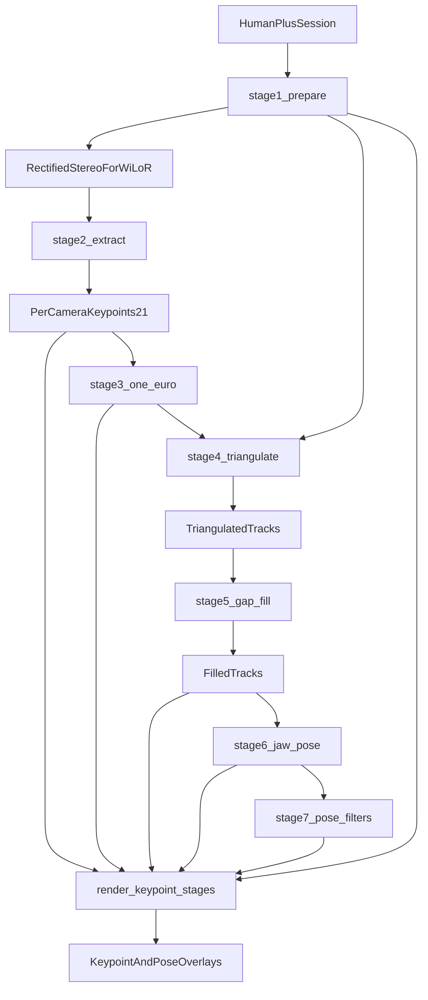

# HumanPlus 到夹爪位姿的七步架构

本文只定义 `my_retargeting` 的模块边界和数据契约。它不实现算法，也不调用 `new_retargeting` 或 `ssh_run_all` 的代码。算法在本目录重写。

管线把一个 HumanPlus 双目 session 变成可审计的 21 点轨迹，再变成左右夹爪位姿。机器人基座、IK、碰撞和仿真评测不在范围内。MediaPipe 也不在范围内；检测后端固定为 WiLoR。

编排脚本 `run_humanplus_wilor.py` 只放顶层 `CONFIG`，并按顺序调用下面的阶段。它自己不是算法模块。库模块接收显式冻结配置，不读脚本全局变量，不用 argparse。关键点和每一档夹爪位姿视频由 `test/render_keypoint_stages.py` 画在校正视频上。它只读已保存的轨迹。

## 1. 数据流

```text
HumanPlus session
        │
        ▼
1_prepare_humanplus
        │  校正双目视频 + 针孔模型 + 原始鱼眼引用
        ▼
2_extract_wilor
        │  左右相机各 21 点，像素在校正帧上
        ▼
3_smooth_keypoints
        │  按解剖左右手做 One-Euro；缺帧重置滤波器
        ▼
4_triangulate_keypoints
        │  左校正相机坐标系下的米制测量，无效点为 0
        ▼
5_fill_keypoints
        │  整帧门控、2.5 m/s 作废、短缺口插值、长缺口保持
        ▼
6_map_gripper_pose
        │  拇指–食指颌平面：位置、朝向、米制开合
        ▼
7_filter_gripper_pose
        │  可关闭的位姿后处理，每段各存一份
        ▼
render_keypoint_stages
        │
        └── 关键点三份 + 每一档夹爪位姿叠图
```

左右相机各自检测。一只手失败不改另一只。每一阶段返回新对象，不覆盖上一阶段结果。三角测量里的无效点用 0 加掩码表示，以便和 SSH 的全零缺失帧一致。



模块 2 只读校正视频。原始视频、原始 HDF5 和原始鱼眼标定全程只读。模块 3 平滑的是校正像素和手腕相对 3D；三角测量只消费平滑后的像素。

## 2. 模块 1：`1_prepare_humanplus`

把一个 HumanPlus session 变成 WiLoR 能直接逐帧读取的双目输入。

WiLoR 吃整帧 RGB，并假定关键点像素就是这张图的像素。HumanPlus 原始画面是 OpenCV 四参数鱼眼。鱼眼像素不能当作 WiLoR 输入，也不能送进后面的针孔三角化。

### 职责

- 读取左右鱼眼视频、时间戳、鱼眼内参和 `T_rig_from_camera`。
- 按时间戳配成同步帧对。失配帧保留状态，不借邻帧。
- 把两路鱼眼校正成 `RECTIFIED_PINHOLE` 视频，同时写出对应针孔内参和外参。校正旋转写回外参。三角测量使用这些校正相机，点落在左校正相机坐标系。
- 保留指向原始鱼眼视频和原始标定的引用。验收叠图画在校正视频上。

### 不做

不运行 WiLoR，不检测手，不做时序滤波，不渲染，不改写原始文件。

### 输入

`HumanPlusSession`：一个 session 根目录。调用方给出左右相机标识，默认 `fisheye_left` 与 `fisheye_right`，以及允许的最大同步时间差。

### 输出

`RectifiedStereoForWiLoR`：

- 左右校正视频路径，像素空间为 `RECTIFIED_PINHOLE`。
- 与源视频对齐的帧号和纳秒时间戳。
- 每路更新后的针孔内参，以及已吸收校正旋转的 `T_rig_from_camera`。
- 原始左右鱼眼视频路径和原始鱼眼标定。验收叠图使用校正视频。
- 每个帧对的同步状态。未同步的帧对不能进入三角化。

## 3. 模块 2：`2_extract_wilor`

只在模块 1 的校正视频上跑 WiLoR。左右相机各一个会话。

### 职责

- 逐帧读取校正 RGB，调用 WiLoR。
- 把 crop 内坐标变回校正帧的整帧像素后再输出。
- 每帧、每只手输出恰好 21 个点，像素空间等于该校正帧。
- 把 MANO、弱透视相机和模型相对 3D 放进审计字段。这些字段不是米制相机坐标，不能进入三角化。
- 保留检测器给出的左右手标签和置信度，但只作为软证据。最终左右手身份不在本模块决定。
- 缺手、帧读失败和模型异常写成显式状态。不补一个假的 21 点。

### 不做

不读 HumanPlus 目录布局，不校正鱼眼，不关联左右视图，不三角化，不滤波，不写叠图。

### 输入

`RectifiedStereoForWiLoR` 中的左右校正视频、帧引用，以及 WiLoR 配置：设备、最低检测置信度、每帧最多两只手。像素空间必须已经是 `RECTIFIED_PINHOLE`；否则拒绝检测。

### 输出

`PerCameraKeypoints21`，左右各一条，与输入帧等长：

- `camera_id`、`source_frame_index`、`timestamp_ns`、`pixel_space`。
- 每帧 0 到 2 个观测。每个观测含 `points_px (21, 2)`、逐点置信度、检测置信度、报告的左右手和其置信度。
- `processing_status`：`SUCCESS`、`NO_HAND`、`FRAME_UNAVAILABLE` 或 `BACKEND_ERROR`。
- 审计元数据：后端名、版本、crop 变换、模型相对 3D。审计字段不得作为几何输入传出。

## 4. 模块 3：`3_smooth_keypoints`

消费模块 2 的原始观测。它不检测，不三角化，不写视频。

每个校正相机、每只解剖手各有一套 One-Euro。输入是 SSH 的 `image_norm`（像素除以宽高，再补一列 0）和手腕相对 3D。参数是截止频率 `1 Hz`、`beta` `0.3`、导数截止频率 `1 Hz`。时间是 `frame_index / fps`，帧率取该校正视频，读不到时用 `30`。这一帧没有这只手就清掉该手的滤波器，缺口不跨过去平滑。同一只手在一帧里出现两次时保留第一次。平滑后的像素是 `image_norm[:, :2] * (width, height)`。输出重新按 `0=left`、`1=right` 摆放。原始观测不改。平滑后的手腕相对 3D 仍是审计字段，不进入三角测量。

## 5. 模块 4：`4_triangulate_keypoints`

消费模块 3 的平滑像素和模块 1 的校正相机。检测已经在校正针孔图上，所以按 SSH `triangulate_hand_slot(..., pre_undistorted=True)` 做。同一只解剖手的左右平滑像素一起三角化。点在左校正相机坐标系，单位米。两点都看到这只手、左右重投影误差都低于 `10` 像素、且相机 `z > 0` 才有效。无效点写成 `0`。平滑后的手腕相对 3D 不进入这一步。

## 6. 模块 5：`5_fill_keypoints`

消费三角测量结果。左右手分开，整帧一起处理。它不读视频，不调用 WiLoR，不重新三角化，不算夹爪，不再做 One-Euro 或 Savitzky-Golay。

1. **门控。** 21 点都有效，手腕到中指 MCP 的长度在 `(0.055, 0.135)` 米，相机深度在 `(0.10, 1.5)` 米，任意两点距离小于 `0.25` 米。没通过的整帧清零。
2. **作废。** 整帧全零，或者手腕、拇指尖、食指 MCP、食指尖、中指 MCP、无名指 MCP、小指 MCP 里任意一点相对相邻帧的速度超过 `2.5 m/s`。速度是位移乘以视频帧率。相邻帧里已经有缺失帧时，这段速度记为 `0`。
3. **补洞。** 不超过 `10` 帧的内部缺口，63 个坐标按帧序号线性插值。更长的缺口保持前一帧整手姿态。序列开头没有上一帧时，保持后面第一个有效姿态。

原始测量留在 `raw`。`invalid_mask` 是补洞用的整帧掩码。`points_m` 是补洞后的姿态。模块 6 只读这份结果，不改 21 点。

## 7. 模块 6：`6_map_gripper_pose`

消费模块 5 的补洞轨迹。左右手分开。它只计算夹爪位姿，不做轨迹后处理，不读视频，不三角化，不跑 IK。

几何在 `gripper_pose/jaw_geometry.py`。入口文件只调用它。

- 位置是拇指尖到食指尖的中点，单位米，坐标系仍是左校正相机。
- 开合距离是这两点的长度，单位米。归一化宽度留空。
- 朝向是拇指–食指颌平面。前伸轴从手腕指向 `0.7 * 食指尖 + 0.3 * 中指尖`。四元数是 scipy 的 xyzw。
- 开合距离低于 `0.01` 米，或颌平面正弦低于 `0.15` 时，朝向保持上一帧有效值。这是为了得到可用朝向，不是轨迹滤波。

两个开关默认打开，关掉后就是纯几何：

- `smooth_closing_inputs`：颌线形成前，对拇指尖和食指尖做 `0.1` 的 EMA。
- `smooth_reach_inputs`：前伸轴形成前，对手腕、食指尖、中指尖做窗口 5、3 倍标准差的 Hampel，再做 `0.15` 的 EMA。

输出 `GripperPoses`，文件名 `gripper_pose_raw.npz`。

## 8. 模块 7：`7_filter_gripper_pose`

消费模块 6 的原始位姿。它不重算颌平面，不改 21 点。每一段是一个函数，输入一份位姿，返回一份新位姿。`enabled_stages` 决定哪些段运行。名单里没有的段被跳过，上一份位姿原样传下去。顺序固定，不能靠名单打乱：

1. `long_gap_blend`：用模块 5 已有的无效掩码，把长断档末尾的位置、开合距离和朝向过渡到下一段测量。
2. `width_one_euro`：用有效帧开合距离的 2% 和 98% 分位归一化，再做截止频率 1 Hz、`beta` 15 的 One-Euro，并裁到 `[0, 1]`。
3. `position_velocity_outlier`：按整段中位数速度剔除位置离群帧。
4. `position_savgol`：位置做窗口 21、3 阶 Savitzky-Golay。
5. `orientation_velocity_outlier`：按整段中位数转角剔除朝向离群帧。
6. `orientation_gaussian_slerp`：朝向做 sigma 10 帧、核 21 的高斯 SLERP。

默认六段都开。每跑完一段写入 `gripper_pose_after_<阶段名>.npz`。最后一段同时写入 `gripper_poses.npz`。名单为空时，最终位姿就是模块 6 的原始结果。

滤波公式在 `gripper_pose/pose_filters.py` 和 `gripper_pose/gap_blend.py`。入口文件不含公式。

## 9. 验收脚本：`render_keypoint_stages`

读同一次运行的模块 5 补洞点，以及模块 6 的 `gripper_pose_raw.npz` 和模块 7 的 `gripper_poses.npz`。在校正视频上各写一份 MP4：`gripper_pose_module6.mp4` 和 `gripper_pose_module7.mp4`。先画 Dex1 夹爪，再画手部关键点。默认 4 个进程，每个进程只加载一次网格并顺序解码自己的一段帧；画完一帧就写成临时图片，主进程按帧号写入 MP4 并打印进度。

## 10. 跨模块不变量

- 帧号和纳秒时间戳从 session 传到修复轨迹，各阶段长度相同。
- 模块 2 的像素空间必须等于校正视频的 `RECTIFIED_PINHOLE`。
- 三角测量的坐标帧是 `left_rectified_camera`，单位为米。无效点为 0，并用 `point_valid_mask` 区分。
- 模型相对 3D 可以在模块 3 被平滑，但不得进入三角化。
- 几何拒绝和缺检测都留下原因。模块 5 可以给无效帧填上保持或插值姿态，原始测量不改。
- 夹爪位姿的坐标帧仍是 `left_rectified_camera`。模块 7 不把归一化宽度写回 21 点。
- 七个阶段之间只传递冻结数据对象。算法模块不写展示文件。叠图只由验收脚本写出，且不回写轨迹。
- 模块 7 的阶段可以单独关闭。关闭后的输出必须等于关闭前的那一份位姿。

## 11. 目录

```text
my_retargeting/
├── 架构设计.md
├── pipeline/
│   ├── contracts.py
│   ├── 1_prepare_humanplus.py
│   ├── 2_extract_wilor.py
│   ├── 3_smooth_keypoints.py
│   ├── 4_triangulate_keypoints.py
│   ├── 5_fill_keypoints.py
│   ├── 6_map_gripper_pose.py
│   ├── 7_filter_gripper_pose.py
│   ├── gripper_pose/
│   │   ├── jaw_geometry.py
│   │   ├── pose_filters.py
│   │   └── gap_blend.py
│   └── run_humanplus_wilor.py
└── test/
    └── render_keypoint_stages.py
```

`run_humanplus_wilor.py` 的 `CONFIG` 包含 session 路径、WiLoR 设备、检测阈值、同步差、重投影阈值、速度阈值、长缺口帧数、模块 6 的两个输入平滑开关、模块 7 的 `enabled_stages` 和输出目录。库模块不导入这份 `CONFIG`，也不导入 `ssh_run_all`。

## 12. 这次不包含

MediaPipe、机器人基座、URDF、TCP 偏置、IK、碰撞和仿真评测。
